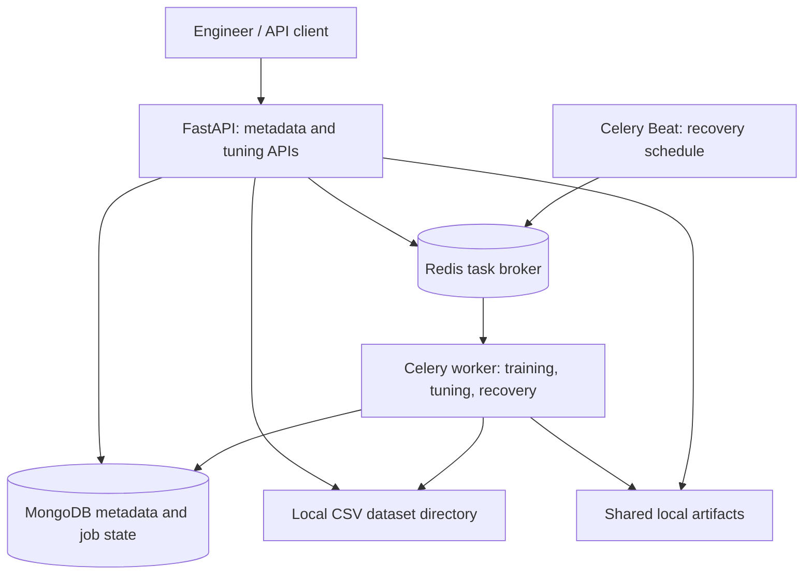

# ML Pipeline Pro

ML Pipeline Pro currently provides a local REST API and CPU workers for reproducible classification experiments and bounded hyperparameter tuning. The broader product will add conversational pipeline management, monitoring, and reviewable Python code generation.

**Development status, October 6, 2026:** Version `0.1.0` has completed the initial scope of milestones 1-3: the foundation, experiment tracking, and serial Optuna tuning. Register datasets/models, train or tune through Celery, inspect results, cancel searches, download verified artifacts, and explicitly register model versions. The broader MVP remains in development. The audit's tuning recovery ownership bugs are fixed with transactional parent/child writes; process-loss and outage validation remain before expanding worker concurrency.

Read the [project audit and development status](docs/project-status.md) for verified capabilities, open findings, and immediate priorities. [PLAN.md](PLAN.md) defines the remaining milestones and acceptance criteria.

Development follows the [AI-assisted engineering method](docs/development-methodology.md): clarify and challenge ideas, commit design plans for human review, then implement with continuous verification. [AGENTS.md](AGENTS.md) carries the shared rules and checks; [project memory](docs/memory/README.md) preserves evidence-linked findings.

Follow the [classification walkthrough](docs/experiments.md) for experiment requests, or the [tuning walkthrough](docs/tuning.md) for a five-trial search within a five-minute budget. Both include demos that run without services. The next feature milestone is conversational access to these verified APIs.

## Problem and purpose

Machine learning engineers often move between training scripts, experiment records, tuning tools, and monitoring dashboards to understand how a model was built and why its performance changed. ML Pipeline Pro aims to connect these workflows through shared experiment metadata and an AI assistant that grounds its suggestions in recorded results.

The supplied concept describes workflow pain points from 2025. This project will validate those assumptions with user feedback and measured benchmarks during implementation.

## Capabilities and development state

- **Implemented - model and experiment tracking:** Project-scoped datasets/models, idempotent CPU training, validation-based comparison, explicit version registration, and verified artifacts.
- **Implemented - bounded tuning:** Serial Optuna TPE searches with retained trial configurations/outcomes, cooperative cancellation, reservation replay, and final holdout evaluation of the selected checkpoint.
- **Implemented - local deployment:** One Docker image, a five-service Compose stack, locked dependencies, and GitHub Actions checks.
- **Planned - conversation:** LangChain/provider integration, structured API tools, project-scoped dialogue/action records, and evidence-linked explanations.
- **Planned - monitoring:** Prometheus/Grafana, observations, drift/quality summaries, alerts, and evidence-grounded diagnosis.
- **Planned - code generation and shared deployment:** Validated snippets, reviewed execution, identity/roles, object storage, backup/restore, and Kubernetes.

## Technology stack

| Area | Implemented | Planned extensions |
| --- | --- | --- |
| Language and packaging | Python, Hatchling, uv, lockfile | Broader platform validation |
| REST APIs | FastAPI, Pydantic, Uvicorn | Conversation and monitoring endpoints |
| AI orchestration | None | LangChain and a configurable model provider |
| Training | CPU PyTorch MLP classification, NumPy | Additional adapters; TensorFlow deferred |
| Metadata | MongoDB with async PyMongo; six domain collections | Conversations, action audit, monitoring summaries/alerts |
| Optimization | Seeded serial Optuna TPE | Additional search parameters and parallel trials |
| Background work | Celery/Redis, scheduled recovery, transactional tuning ownership | Process-loss/outage validation and operational checks |
| Data and artifacts | Local CSV references, atomic local artifact writes and verification | Immutable dataset storage, object storage, retention |
| Diagnostics | JSON logs, redaction, dependency health endpoints | Prometheus/Grafana and worker/queue monitoring |
| Testing and CI | pytest/coverage, Ruff, dependency audits, GitHub Actions | AI evaluations, process-loss/load/restore checks |
| Deployment | Docker image and local Compose stack | Shared deployment controls and Kubernetes |

FastAPI, PyMongo, configuration tooling, Uvicorn, Celery, and a Redis client are core dependencies. The optional `training` extra adds NumPy, CPU PyTorch, and Optuna. The remaining stack will be introduced as its workflows are built. Reinforcement learning for tuning is deferred until there is evidence it improves on the Bayesian baseline.

## Current architecture

One modular FastAPI application in `src/ml_pipeline_pro` serves metadata and tuning APIs. Celery executes training, tuning, and recovery tasks; a separate Beat process schedules recovery. MongoDB owns durable metadata and job status; Redis transports tasks. The diagram shows only implemented components. Separate service deployment will follow measured scaling needs.



The tracking module owns datasets, models, experiments, and model versions. The tuning module owns jobs and trials and writes training results through tracking repositories. Background workers keep training workloads out of API request handlers. Monitoring and conversation modules are not present yet.

MongoDB stores metadata and artifact references rather than large model binaries. Completed experiments expose validation/test metrics. Production observations, quality history, and drift collection are future monitoring work. Registering a model version does not deploy it or provide inference serving.

## Example intended workflow

1. Register a dataset and a model configuration.
2. Ask: “Create a classification experiment using this dataset and track validation F1.”
3. Review the assistant's structured configuration and submit the experiment.
4. Ask: “Tune the learning rate and batch size for up to 20 trials within a five-minute budget.”
5. Compare trial results and register the selected model version.
6. Inspect monitoring dashboards and ask for an explanation of a performance change.
7. Request a Python integration snippet, review it, and run it in an isolated environment.

These examples illustrate planned behavior; no runnable conversational interface is available yet.

## Development setup

### Run the whole local stack

Install Docker with Compose 2.24 or later, then run from the repository root:

```powershell
docker compose up --build --wait --wait-timeout 300
Invoke-RestMethod http://127.0.0.1:8000/api/v1/health/ready
```

Open [the API documentation](http://127.0.0.1:8000/docs). The current endpoints are:

| Endpoint | Meaning |
| --- | --- |
| `GET /api/v1/health/live` | Process is running; does not contact dependencies |
| `GET /api/v1/health/ready` | MongoDB and Redis both respond within the configured timeout |
| `POST /api/v1/datasets` | Validate a local CSV and register its content hash and split metadata |
| `GET /api/v1/datasets` and `GET /api/v1/datasets/{id}` | List or retrieve datasets within a project |
| `POST /api/v1/models` | Register a PyTorch classification model |
| `GET /api/v1/models` and `GET /api/v1/models/{id}` | List or retrieve models within a project |
| `POST /api/v1/experiments` | Queue a bounded training job; requires `Idempotency-Key` |
| `GET /api/v1/experiments` and `GET /api/v1/experiments/{id}` | Filter experiments or retrieve status, metrics, and artifacts |
| `GET /api/v1/experiments/compare` | Compare completed experiments using validation metrics |
| `GET /api/v1/experiments/{id}/artifacts/{name}` | Download a hash-verified checkpoint or manifest |
| `POST /api/v1/models/{id}/versions` | Register a model version from a completed experiment |
| `GET /api/v1/models/{id}/versions` and `GET /api/v1/models/{id}/versions/{version_id}` | Retrieve registered model versions |
| `POST /api/v1/tuning-jobs` | Queue a bounded TPE search; requires `Idempotency-Key` |
| `GET /api/v1/tuning-jobs` and `GET /api/v1/tuning-jobs/{id}` | Retrieve tuning status, budgets, and the selected configuration |
| `GET /api/v1/tuning-jobs/{id}/trials` | Inspect trial parameters, metrics, durations, and failures |
| `POST /api/v1/tuning-jobs/{id}/cancel` | Cancel queued tuning or cooperatively stop an active trial |

Readiness returns `503` with each dependency's status when either service is unavailable. Responses include `X-Correlation-ID`; an optional valid caller ID is preserved in the response and request logs. Errors contain `error.code`, `error.message`, and `error.correlation_id`.

Readiness checks MongoDB/Redis connectivity. Experiment status and heartbeat timestamps show worker progress separately.

Compose runs the API, a training worker, a recovery scheduler, MongoDB, and Redis. It publishes ports 8000, 27017, and 6379 on localhost and retains metadata, Redis data, and artifacts in named volumes. The worker has one CPU, 1 GiB of memory, and one concurrent job. Compose explicitly sets `MLPP_ENVIRONMENT=development` and container connection/storage paths; an `.env` environment value does not override these settings. Metadata endpoints require `X-Project-ID` and enforce `X-API-Key` when project keys are configured. Shared deployment still needs the controls listed in the [audit](docs/project-status.md#deployment-and-operational-gaps). Stop the stack with `docker compose down`; its named volumes remain available for the next startup.

Tuning requires MongoDB transactions. Compose initializes a single-node `mlpp` replica set and waits for a writable primary. When upgrading an existing local stack, run `docker compose up --build --wait --wait-timeout 300`; the existing MongoDB volume is retained. Host connections to this container must use `mongodb://127.0.0.1:27017/?directConnection=true`, including an existing `.env`, because the replica set advertises its container hostname. External MongoDB deployments must support transactions through a replica set or sharded cluster; standalone MongoDB can still serve ordinary experiments but cannot execute tuning.

The checked-in CSV is included in the image. Custom data must be mounted at the same relative path under the dataset root for the API and worker. Registration records a hash and reference; it does not upload or copy the source file.

### Develop the API on your host

Install [uv](https://docs.astral.sh/uv/getting-started/installation/). The project defaults to Python 3.11; uv can provision it if needed. Versions 3.11 through 3.14 are allowed by the manifest, while CI tests 3.11/3.13 on Linux and local validation uses Windows/Python 3.11. From the repository root:

```powershell
uv sync --locked
Copy-Item .env.example .env
docker compose up --wait mongo redis
uv run --locked uvicorn ml_pipeline_pro.main:create_app --factory --reload --no-access-log
```

For queued experiments with the host API, also start the container worker and scheduler with `docker compose up --build --wait mongo redis worker scheduler`. Both use the same MongoDB/Redis and checked-in dataset. To download artifacts through the host API, replace the named artifact volume with a shared host directory mounted at `/app/artifacts` in the containers and set the host's `MLPP_ARTIFACT_ROOT` to that directory. Running the whole stack in Compose already shares artifact storage correctly.

The API runs at `http://127.0.0.1:8000`. Select `.venv/Scripts/python.exe` as the Python interpreter in your Windows editor. On macOS or Linux, use `cp .env.example .env` and `.venv/bin/python`.

If Docker or the dependency services are not installed yet, the API still starts: liveness and `/docs` work, and readiness returns `503`. The foundation's unit tests also run without MongoDB, Redis, or language model credentials.

Configuration uses the `MLPP_` prefix. `.env.example` lists connection URLs, dataset/artifact directories, data limits, project keys, and worker recovery limits. Environment variables override `.env`. Credentials belong in `.env` or the environment, outside source control. Connection URLs are treated as secrets; configured passwords and project keys are redacted from application and client logs.

### Run checks

```powershell
uv sync --locked --extra training
uv run --locked --extra training ruff check .
uv run --locked --extra training ruff format --check .
uv run --locked --extra training pytest -m "not integration" --cov
uv pip check
```

For all integration tests, start the full stack, then enable both flags:

```powershell
docker compose up --build --wait --wait-timeout 300
$env:MLPP_RUN_INTEGRATION = '1'
$env:MLPP_RUN_WORKER_INTEGRATION = '1'
try {
    uv run --locked --extra training pytest -m "integration and not recovery"
} finally {
    Remove-Item Env:MLPP_RUN_INTEGRATION
    Remove-Item Env:MLPP_RUN_WORKER_INTEGRATION
}
```

On macOS/Linux use `MLPP_RUN_INTEGRATION=1 MLPP_RUN_WORKER_INTEGRATION=1 uv run --locked --extra training pytest -m "integration and not recovery"`. Omitting the worker flag skips three queued workflow cases. Omitting the training extra can skip real-training unit modules and prevents the direct tuning-recovery integration case from running successfully. Tests delete their own generated metadata; queued test artifacts remain in the shared artifact volume. See the [validation report](docs/test-validation.md#repeat-the-full-suite) for an isolated stack and endpoint overrides.

The separate [recovery suite](docs/recovery.md) builds the current checkout into its own Compose stack to kill workers and stop MongoDB/Redis at controlled boundaries. Run it serially with `MLPP_RUN_RECOVERY_INTEGRATION=1` and `pytest -m recovery`. It verifies Beat-driven recovery after natural lease expiry, preserved tuning results/deadlines, attempt exhaustion, and retained submissions after queue outages. CI uploads its state snapshots, logs, and JUnit report.

The October 6 baseline audit reran **126 unit/API/training/tuning tests and all nine real-service tests successfully**, plus both demos, Ruff, installed dependency compatibility, and runtime dependency audits. GitHub Actions checks Python 3.11/3.13 and a rebuilt Compose stack. All three jobs passed for the audited baseline, [0e37e6e](https://github.com/JacobHermsmeyer21/ML-Pipeline-Pro/actions/runs/37541937953). These baseline checks predate the ownership fix described below.

The subsequent ownership and manifest recovery fixes pass **129 local tests and 20 real-service tests** against a rebuilt isolated Compose stack. These include ten real-MongoDB cases that transfer parent ownership between a transaction's snapshot read and child mutation, plus interrupted final-evaluation persistence. See the [updated audit](docs/project-status.md#ownership-fix-validation) for validation of the fixed behavior.

The [ten-iteration validation report](docs/test-validation.md) records 1,350 passing test executions, including 90 real-service checks, with no failures or skips. It includes measured coverage, saved evidence locations, and commands for repeating the suite against an isolated test stack.

`pyproject.toml` declares dependency ranges; `uv.lock` records exact versions and hashes. Use `uv sync --locked` for the API or `uv sync --locked --extra training` for training/tuning and their tests. Keep the extra on subsequent `uv run` commands that need training so dependency synchronization retains it. PyTorch comes from its CPU index on Windows/Linux. LangChain/provider integrations will follow in the next feature milestone.

### Source layout

```text
src/ml_pipeline_pro/
  main.py           # Application factory and versioned health endpoints
  config.py         # Validated environment configuration
  connections.py    # Async client lifecycle and dependency checks
  errors.py         # Consistent API errors
  logging.py        # JSON request logs and credential redaction
  repositories.py   # Record schema and project-scoped repository contract
  ownership.py      # Transactional parent fences for tuning child writes
  schemas.py        # Dataset, model, experiment, and model version schemas
  api.py            # Metadata, experiment, comparison, and artifact endpoints
  access.py         # Project selection and optional API key enforcement
  datasets.py       # Bounded CSV validation and explicit splits
  tracking.py       # Owned repositories and MongoDB indexes
  jobs.py           # Atomic worker claims, heartbeats, and completion
  queue.py          # Celery configuration and Redis dispatch
  worker.py         # Training and recovery tasks
  execution.py      # Job execution and terminal status reporting
  training.py       # Deterministic CPU PyTorch adapter
  artifacts.py      # Artifact writes, hashing, and download verification
  tuning_schemas.py # Search spaces, budgets, and job/trial contracts
  tuning_store.py   # Tuning-owned collections, leases, and reservations
  tuning_api.py     # Tuning submission, progress, and cancellation
  tuning_sampler.py # Seeded TPE suggestions from durable history
  tuning_execution.py # Serial search and final holdout evaluation
  training_control.py # Deadlines, cancellation, and ownership checks
tests/
  integration/      # Opt-in tests against real MongoDB and Redis
compose.yaml        # API and local dependencies
.github/workflows/  # CI checks and Compose smoke test
```

## Reliability and planned execution boundaries

Today the backend validates typed requests, enforces project scoping and optional project keys, records hashes/configuration/dependencies, and bounds serial workers. Tuning child writes now check and write the owning parent within the same MongoDB transaction, rejecting stale claims and results across collections. Further recovery and deployment work remains in the [audit](docs/project-status.md#open-audit-findings). The following requirements for the future assistant and generated-code execution remain planned:

- Validate AI-generated actions against typed schemas, authorized tools, and project access permissions.
- Require engineer approval for generated code execution and model promotion.
- Run generated code and training jobs in isolated workers with bounded CPU, memory, runtime, and network access.
- Record dataset versions, random seeds, dependency versions, and artifact hashes to support reproducibility.
- Apply trial limits and runtime budgets independently of language model suggestions.
- Treat assistant recommendations as hypotheses and provide the measurements used to derive them.

## Success measures

The supplied resume summary includes the following numbers. They are **unverified target hypotheses**, not achieved results or resume-ready claims.

| Proposed target | Validation approach |
| --- | --- |
| Up to 10x faster metadata retrieval | Compare indexed retrieval with a documented baseline using identical data and queries |
| 30% less tuning time | Compare time to a fixed quality threshold under equal compute budgets |
| 40% less debugging and optimization time | Measure time to resolve seeded performance issues in comparable tasks |
| 25% higher coding efficiency | Measure completion time and correctness for repeated pipeline integration tasks |
| 50% higher model throughput | Compare successful completed model workflows per unit time under fixed resources |

Publish workload definitions, baselines, sample sizes, and results before making quantitative claims. See the [measurement plan](PLAN.md#measurement-and-reporting).

## Documentation roadmap

The quickstart, [classification tutorial](docs/experiments.md), [tuning guide](docs/tuning.md), [recovery validation guide](docs/recovery.md), [project audit/status](docs/project-status.md), and [historical validation report](docs/test-validation.md) are included. Conversation, monitoring, code-generation, shared-deployment, backup/restore, and operations guides remain to be written as those features are implemented. See [PLAN.md](PLAN.md#immediate-development-priorities) for the next work and completion gates.
