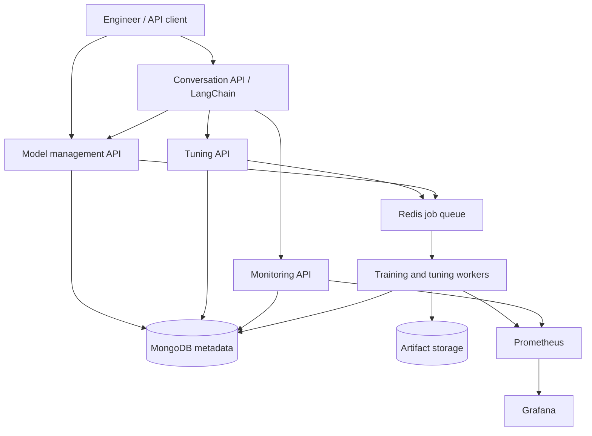

# ML Pipeline Pro

ML Pipeline Pro is an AI-assisted platform in development for creating, tracking, tuning, and monitoring machine learning pipelines. Engineers will use a conversational interface to turn natural language requests into structured pipeline actions, inspect experiments, and generate Python code for common workflows.

**Project status:** Initial classification experiment workflow implemented. Register datasets and models, submit idempotent Celery training jobs, inspect results, compare validation metrics, download verified artifacts, and register model versions. The CPU PyTorch adapter is tested locally with a synthetic dataset. Docker and real-service integration execution remain unverified on the initial Windows machine. Tuning, monitoring, and conversational features remain planned.

See [PLAN.md](PLAN.md) for implementation phases, acceptance criteria, and validation strategy.

Follow the [classification walkthrough](docs/experiments.md) for API requests, result retrieval, and a training demo that runs without Docker. The next feature milestone is bounded hyperparameter tuning, after real-service integration verification.

## Problem and purpose

Machine learning engineers often move between training scripts, experiment records, tuning tools, and monitoring dashboards to understand how a model was built and why its performance changed. ML Pipeline Pro aims to connect these workflows through shared experiment metadata and an AI assistant that grounds its suggestions in recorded results.

The supplied concept describes workflow pain points from 2025. This project will validate those assumptions with user feedback and measured benchmarks during implementation.

## Planned capabilities

- **Conversational pipeline management:** Use LangChain to interpret requests, guide pipeline creation, and explain experiment results.
- **Model and experiment tracking:** Record model versions, datasets, hyperparameters, evaluation metrics, and artifact references in MongoDB.
- **Automated hyperparameter tuning:** Run bounded Bayesian optimization jobs and retain every trial's configuration and outcome.
- **Performance monitoring:** Collect operational and model metrics, surface anomalies, and produce AI-assisted explanations linked to supporting evidence.
- **Python code generation:** Draft pipeline snippets for engineer review and validation before execution.
- **Deployment support:** Package services in Docker, start locally with Compose, and introduce Kubernetes after the core workflows are validated.

## Proposed technology stack

| Area | Initial choice | Purpose |
| --- | --- | --- |
| Language | Python | Service implementation and ML ecosystem integration |
| REST APIs | FastAPI | Typed request validation and API documentation |
| AI orchestration | LangChain with a configurable language model provider | Conversation handling and structured tool calls |
| Model training | PyTorch initially; TensorFlow as a later adapter | Train and evaluate supported models |
| Metadata | MongoDB with PyMongo | Store experiments, model versions, trial results, and conversations |
| Optimization | Optuna with a Bayesian optimization sampler | Search hyperparameters within explicit resource budgets |
| Background work | Celery with Redis | Execute long-running training and tuning jobs |
| Artifacts | Local storage for development; object storage for deployment | Store datasets, checkpoints, and evaluation outputs outside MongoDB |
| Observability | Prometheus and Grafana | Collect metrics and visualize system and model health |
| Testing and CI | pytest and GitHub Actions | Validate behavior and automate checks |
| Packaging and deployment | Docker Compose, then Kubernetes | Local development and scalable deployment |

FastAPI, PyMongo, configuration tooling, Uvicorn, Celery, and a Redis client are core dependencies. The optional `training` extra adds NumPy and CPU PyTorch. The remaining stack will be introduced as its workflows are built. Reinforcement learning for tuning is deferred until there is evidence it improves on the Bayesian baseline.

## Proposed architecture

The current implementation is one FastAPI application in `src/ml_pipeline_pro`. Future model management, tuning, monitoring, and conversation modules will share explicit contracts in this application first. Separate deployment of services will follow measured scaling needs. The diagram describes the intended responsibilities and integrations.



The model management service owns model and experiment records. The tuning service schedules optimization jobs and records trials. The monitoring service exposes performance history and alert context. The conversation service calls validated APIs and returns evidence-linked explanations. Background workers keep training workloads out of API request handlers.

MongoDB stores metadata and artifact references rather than large model binaries. Training metrics are available immediately; production quality metrics depend on obtaining ground-truth labels. Operational metrics, such as latency and error rate, are tracked separately from model quality and data drift.

## Example intended workflow

1. Register a dataset and a model configuration.
2. Ask: “Create a classification experiment using this dataset and track validation F1.”
3. Review the assistant's structured configuration and submit the experiment.
4. Ask: “Tune the learning rate and batch size for up to 20 trials within a two-hour budget.”
5. Compare trial results and register the selected model version.
6. Inspect monitoring dashboards and ask for an explanation of a performance change.
7. Request a Python integration snippet, review it, and run it in an isolated environment.

These examples illustrate planned behavior; no runnable conversational interface is available yet.

## Development setup

### Run the whole local stack

Install Docker with Compose 2.24 or later, then run from the repository root:

```powershell
docker compose up --build --wait --wait-timeout 300
Invoke-RestMethod http://127.0.0.1:8000/api/v1/health/ready
```

Open [the API documentation](http://127.0.0.1:8000/docs). The current endpoints are:

| Endpoint | Meaning |
| --- | --- |
| `GET /api/v1/health/live` | Process is running; does not contact dependencies |
| `GET /api/v1/health/ready` | MongoDB and Redis both respond within the configured timeout |
| `POST /api/v1/datasets` | Validate a local CSV and register its content hash and split metadata |
| `GET /api/v1/datasets` and `GET /api/v1/datasets/{id}` | List or retrieve datasets within a project |
| `POST /api/v1/models` | Register a PyTorch classification model |
| `GET /api/v1/models` and `GET /api/v1/models/{id}` | List or retrieve models within a project |
| `POST /api/v1/experiments` | Queue a bounded training job; requires `Idempotency-Key` |
| `GET /api/v1/experiments` and `GET /api/v1/experiments/{id}` | Filter experiments or retrieve status, metrics, and artifacts |
| `GET /api/v1/experiments/compare` | Compare completed experiments using validation metrics |
| `GET /api/v1/experiments/{id}/artifacts/{name}` | Download a hash-verified checkpoint or manifest |
| `POST /api/v1/models/{id}/versions` | Register a model version from a completed experiment |
| `GET /api/v1/models/{id}/versions` and `GET /api/v1/models/{id}/versions/{version_id}` | Retrieve registered model versions |

Readiness returns `503` with each dependency's status when either service is unavailable. Responses include `X-Correlation-ID`; an optional valid caller ID is preserved in the response and request logs. Errors contain `error.code`, `error.message`, and `error.correlation_id`.

Readiness checks MongoDB/Redis connectivity. Experiment status and heartbeat timestamps show worker progress separately.

Compose runs the API, a training worker, a recovery scheduler, MongoDB, and Redis. It publishes ports 8000, 27017, and 6379 on localhost and retains metadata, Redis data, and artifacts in named volumes. The worker has one CPU, 1 GiB of memory, and one concurrent job. This configuration is for local development. Metadata endpoints require `X-Project-ID` and enforce `X-API-Key` when project keys are configured. A complete identity/authorization design is still needed before shared deployment. Stop the stack with `docker compose down`; its named volumes remain available for the next startup.

### Develop the API on your host

Install [uv](https://docs.astral.sh/uv/getting-started/installation/). The project defaults to Python 3.11; uv can provision it if needed. Versions 3.11 through 3.14 are allowed by the manifest. From the repository root:

```powershell
uv sync --locked
Copy-Item .env.example .env
docker compose up --wait mongo redis
uv run --locked uvicorn ml_pipeline_pro.main:create_app --factory --reload --no-access-log
```

For queued experiments with the host API, also start the container worker and scheduler with `docker compose up --build --wait mongo redis worker scheduler`. Both use the same MongoDB/Redis and checked-in dataset. To download artifacts through the host API, replace the named artifact volume with a shared host directory mounted at `/app/artifacts` in the containers and set the host's `MLPP_ARTIFACT_ROOT` to that directory. Running the whole stack in Compose already shares artifact storage correctly.

The API runs at `http://127.0.0.1:8000`. Select `.venv/Scripts/python.exe` as the Python interpreter in your Windows editor. On macOS or Linux, use `cp .env.example .env` and `.venv/bin/python`.

If Docker or the dependency services are not installed yet, the API still starts: liveness and `/docs` work, and readiness returns `503`. The foundation's unit tests also run without MongoDB, Redis, or language model credentials.

Configuration uses the `MLPP_` prefix. `.env.example` lists connection URLs, dataset/artifact directories, data limits, project keys, and worker recovery limits. Environment variables override `.env`. Credentials belong in `.env` or the environment, outside source control. Connection URLs are treated as secrets; configured passwords and project keys are redacted from application and client logs.

### Run checks

```powershell
uv run --locked ruff check .
uv run --locked ruff format --check .
uv run --locked --extra training pytest -m "not integration" --cov
uv pip check
```

For integration tests, start MongoDB and Redis on the default local ports, then opt in:

```powershell
docker compose up --wait mongo redis
$env:MLPP_RUN_INTEGRATION = "1"
uv run --locked pytest -m integration
Remove-Item Env:MLPP_RUN_INTEGRATION
```

On macOS or Linux, use `MLPP_RUN_INTEGRATION=1 uv run --locked pytest -m integration`. These tests use the default local connection URLs and delete only their own generated test records.

GitHub Actions is configured for linting, formatting, unit/real-training tests on Python 3.11 and 3.13, installed dependency compatibility, a vulnerability audit of locked runtime dependencies and the PyTorch release, and a Compose build/readiness/queued-training integration smoke test. The container and real-service checks require Docker and have not yet been run on the initial Windows development machine. The [walkthrough](docs/experiments.md#validate-the-full-stack) includes the full worker integration command.

`pyproject.toml` declares supported dependency ranges; `uv.lock` records exact resolved versions and hashes. Use `uv sync --locked` for the API or `uv sync --locked --extra training` for training and its tests. PyTorch comes from its CPU index on Windows/Linux. Optuna and LangChain/provider integrations will follow in later milestones.

### Source layout

```text
src/ml_pipeline_pro/
  main.py           # Application factory and versioned health endpoints
  config.py         # Validated environment configuration
  connections.py    # Async client lifecycle and dependency checks
  errors.py         # Consistent API errors
  logging.py        # JSON request logs and credential redaction
  repositories.py   # Record schema and project-scoped repository contract
  schemas.py        # Dataset, model, experiment, and model version schemas
  api.py            # Metadata, experiment, comparison, and artifact endpoints
  access.py         # Project selection and optional API key enforcement
  datasets.py       # Bounded CSV validation and explicit splits
  tracking.py       # Owned repositories and MongoDB indexes
  jobs.py           # Atomic worker claims, heartbeats, and completion
  queue.py          # Celery configuration and Redis dispatch
  worker.py         # Training and recovery tasks
  execution.py      # Job execution and terminal status reporting
  training.py       # Deterministic CPU PyTorch adapter
  artifacts.py      # Artifact writes, hashing, and download verification
tests/
  integration/      # Opt-in tests against real MongoDB and Redis
compose.yaml        # API and local dependencies
.github/workflows/  # CI checks and Compose smoke test
```

## Reliability and execution boundaries

- Validate AI-generated actions against typed schemas, authorized tools, and project access permissions.
- Require engineer approval for generated code execution and model promotion.
- Run generated code and training jobs in isolated workers with bounded CPU, memory, runtime, and network access.
- Record dataset versions, random seeds, dependency versions, and artifact hashes to support reproducibility.
- Apply trial limits and runtime budgets independently of language model suggestions.
- Treat assistant recommendations as hypotheses and provide the measurements used to derive them.

## Success measures

The supplied resume summary includes the following numbers. They are **unverified target hypotheses**, not achieved results or resume-ready claims.

| Proposed target | Validation approach |
| --- | --- |
| Up to 10x faster metadata retrieval | Compare indexed retrieval with a documented baseline using identical data and queries |
| 30% less tuning time | Compare time to a fixed quality threshold under equal compute budgets |
| 40% less debugging and optimization time | Measure time to resolve seeded performance issues in comparable tasks |
| 25% higher coding efficiency | Measure completion time and correctness for repeated pipeline integration tasks |
| 50% higher model throughput | Compare successful completed model workflows per unit time under fixed resources |

Publish workload definitions, baselines, sample sizes, and results before making quantitative claims. See the [measurement plan](PLAN.md#measurement-and-reporting).

## Documentation roadmap

The foundation quickstart and [classification tutorial](docs/experiments.md) are included. Implementation will add a tuning guide, monitoring walkthrough, deployment guide, and troubleshooting notes. Full queued-workflow verification requires the Compose integration suite.
