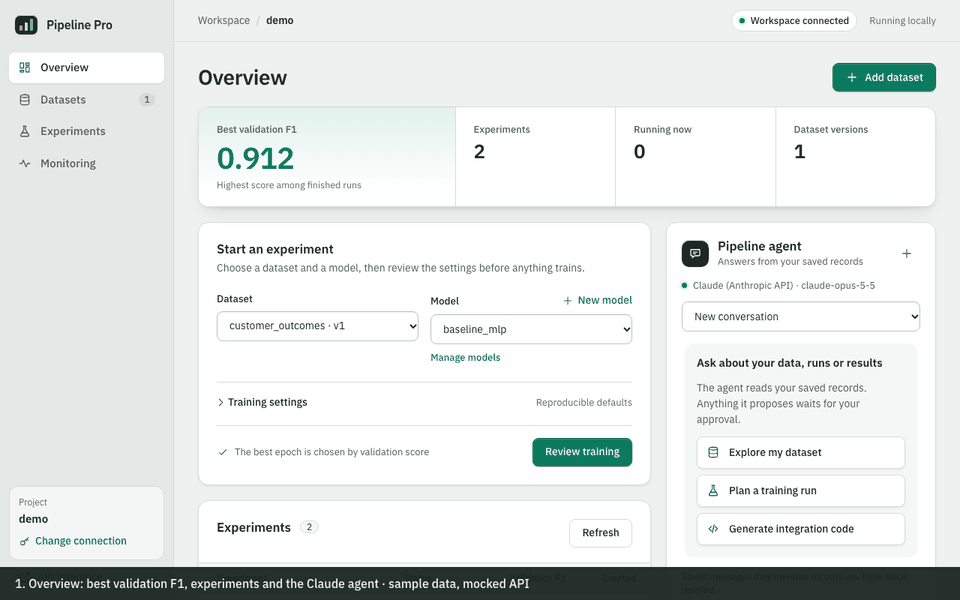

# ML Pipeline Pro

A self-hosted machine learning pipeline: upload a CSV, train and tune PyTorch
classifiers, monitor them in Grafana, and get help from an AI assistant whose
actions always wait for human approval. Built by **Team MJN** as a course project.



*Walkthrough of the dashboard: overview, CSV encoding review, training review, a
queued run, a Claude proposal awaiting approval, and monitoring. Recorded on
October 20, 2026 from the real dashboard with sample data served by the test
suite's mocked API (`frontend/dashboard/tests/demo-capture.spec.ts`).*

## Links

- **Repository:** https://github.com/JacobHermsmeyer21/ML-Pipeline-Pro
- **Live demo:** not deployed yet. The planned public deployment (dashboard on
  Vercel; API, PyTorch and Optuna on Modal; MongoDB Atlas) is described in the
  [deployment plan](docs/plans/2026-10-20-modal-deployment-plan.md). Until then, run
  the app locally with [Installation](#installation) and open
  `http://127.0.0.1:8000/dashboard/`.
- **Progress review slides:** [PDF](docs/presentations/2026-10-20-progress-review/ML-Pipeline-Pro-Progress-Review-Team-MJN.pdf)

## Overview

The goal is to let anyone turn a CSV into a trained, monitored classifier on their
own machines, with Claude as the guide. The platform is split into separate
services, as the course requires:

| Part | Service | What it does |
| --- | --- | --- |
| Data | model API | CSV upload, encoding review, stratified 70/15/15 splits, immutable dataset versions |
| Training | worker + tuning API | Serial CPU PyTorch training; bounded Optuna tuning |
| Monitoring | monitoring API | Inference observations, Prometheus metrics, Grafana panels, AI explanations |
| AI assistant | conversation API | Claude (Anthropic API) or a local model; typed tools; approval before any action |

**Tech stack:**
- **Backend:** FastAPI, MongoDB (replica set), Redis and Celery, PyTorch, Optuna, scikit-learn.
- **AI:** Anthropic Claude SDK, or LangChain with Ollama.
- **Frontend:** Astro with React islands.
- **Monitoring:** Prometheus and Grafana.
- **Delivery:** Docker Compose, Kubernetes, GitHub Actions.

## Features

- Upload an original CSV, review and edit the encoding of each column, and save
  immutable dataset versions, including column-subset versions.
- Train PyTorch MLP classifiers. Each run is submitted exactly once, the best epoch
  is chosen by validation score, and the test split is scored only after selection.
- Run bounded Optuna tuning with cancellation. Winners are picked by validation score.
- Download model artifacts whose SHA-256 and size are verified, and register model
  versions.
- Chat with the Pipeline agent. It reads saved records, proposes training or tuning,
  and drafts Python integration code. Every action needs exact human approval, and
  drafts are never executed.
- Monitor latency, labeled accuracy and errors in Grafana, with an AI explanation of
  the measured window.
- Permanently delete datasets and models after reviewing the exact scope.

## Dataset

- **Example:** [`examples/data/classification.csv`](examples/data/classification.csv)
  has 120 rows (80 train, 20 validation, 20 test), two numeric features, a binary
  `target` and a `split` column. The dashboard offers the same file as a download.
- **Your own data:** upload a UTF-8 CSV with a target column, up to 10 MB and 100,000
  rows by default. Splits are created automatically (stratified 70/15/15, seed 42)
  unless the file has a split column. See
  [raw CSV preparation](docs/reference/api.md#raw-csv-preparation).

## Models and evaluation metrics

- **Model:** a PyTorch MLP (input → hidden units with ReLU → classes), trained with
  Adam and cross-entropy. Runs are deterministic (fixed seed, one CPU thread).
  Features are scaled using training rows only.
- **Selection:** the epoch with the best **validation F1** is kept. Tuning can
  optimise validation F1 or validation accuracy.
- **Reported metrics:**
  - validation F1, validation accuracy and the selected epoch;
  - test F1 and test accuracy, computed once after selection.
- **Example result** (measured October 20, 2026 with `examples/train_local.py` on CPU):
  validation F1 1.000 in about 2 seconds. The example data is deliberately easy, so
  this shows the pipeline works, not model quality.
- **Monitoring metrics:** inference latency, labeled accuracy, error count, and
  declared demo delays per model version.
- **Test suite** (October 20, 2026):
  - 758 fast tests passing, with 80% coverage;
  - 114 integration tests that run against real MongoDB and Redis (in CI);
  - 27 dashboard browser tests.

## Installation

Dependencies are locked: Python in `uv.lock`, and the dashboard in
`frontend/dashboard/package-lock.json`.

### With Docker (full stack)

Install Docker with Compose 2.24 or later. From the repository root:

```powershell
docker compose up --build --wait --wait-timeout 300
Invoke-RestMethod http://127.0.0.1:8000/api/v1/health/ready
```

Open [interactive API docs](http://127.0.0.1:8000/docs). The stack starts the API,
worker, recovery scheduler, MongoDB replica set, and Redis. Metadata requests
require `X-Project-ID` and, when configured, `X-API-Key`. Stop with
`docker compose down`; named volumes retain data and artifacts.

Follow the [setup guide](docs/guides/setup.md) for host development, configuration,
custom data, and shared artifact storage. Chat defaults to disabled; enabling it
still requires an installed model and verified artifact-specific token counter.
Alternatively, the opt-in Claude backend uses the Anthropic API with your own key;
see [conversation development](docs/guides/conversation-development.md#claude-backend).

### On your host (Python)

Install [uv](https://docs.astral.sh/uv/getting-started/installation/), then:

```bash
uv sync --locked --extra training          # API, PyTorch, Optuna, scikit-learn
cp .env.example .env                       # configuration (never commit .env)
uv run --locked --extra training python examples/train_local.py   # train without services
```

To use Claude as the assistant, set `MLPP_CHAT_ENABLED=true`,
`MLPP_CHAT_BACKEND=anthropic` and `MLPP_ANTHROPIC_API_KEY` in `.env`. See the
[Claude backend](docs/guides/conversation-development.md#claude-backend) guide.

### Dashboard (Node 24)

```bash
cd frontend/dashboard
npm ci
npm run build      # writes the packaged dashboard served at /dashboard/
```

## Usage

The [local dashboard](docs/guides/dashboard.md) brings CSV upload, model training,
saved experiments, local-agent chat and embedded Grafana panels into one browser
workspace at `http://127.0.0.1:8000/dashboard/`. Use the dashboard Compose overlay
for durable shared uploads and Grafana embedding. Uploads are disabled by default.
The page is built with Astro; see [developing the dashboard](docs/guides/dashboard.md#develop-the-dashboard).
The additive `POST /api/v1/datasets/upload` accepts raw `text/csv` with dataset
metadata in query parameters; [the API reference](docs/reference/api.md#dataset-upload)
documents its limits, project scope, replay and failure responses.
For original classification CSVs, `POST /api/v1/datasets/preview` proposes editable
encodings and stratified 70/15/15 splits; `POST /api/v1/datasets/prepare` saves the
exact reviewed recipe. Both accept multipart CSV/JSON and use the same opt-in
upload setting. See [raw CSV preparation](docs/reference/api.md#raw-csv-preparation).

Choose input columns before uploading, or use **Edit columns** on a saved dataset
to drop inputs and **Save as new version**. Existing versions/runs retain their
original data; rows, labels and splits are preserved. The additive
`GET /api/v1/datasets/{id}/columns`, `POST /api/v1/datasets/{id}/columns/preview`
and `POST /api/v1/datasets/{id}/columns` routes use the upload opt-in setting.
See [column editing](docs/reference/api.md#dataset-column-editing).

Use **Delete dataset** or **Manage models** in the dashboard to permanently erase
an item and its related training history/checkpoints after reviewing the exact
scope. Related active jobs block deletion; conversations/drafts and shared or
operator-owned inputs are kept. The authenticated deletion-preview, `DELETE`
dataset/model and operation-status routes are documented in
[permanent deletion](docs/reference/api.md#permanent-dataset-and-model-deletion).

For the independently runnable model/tuning APIs, follow
[domain service setup](docs/guides/domain-services.md). Monitoring and Kubernetes
use the [monitoring](docs/guides/monitoring-demo.md) and
[Kubernetes](docs/guides/kubernetes-demo.md) guides.

- [Classification](docs/guides/workflows.md#classification-experiment-walkthrough): register inputs, train, compare, and register a version.
- [Bounded tuning](docs/guides/workflows.md#bounded-classification-tuning): search within trial/runtime limits, inspect results, and cancel.
- [Conversation tools](docs/guides/workflows.md#conversation-tool-layer): use typed tools over the existing API.
- [Generated Python drafts](docs/guides/snippet-generation.md): request, inspect, and review integration snippets through chat.
- [API reference](docs/reference/api.md): endpoints, access headers, errors, and idempotency.
- [Complete midterm demo](docs/guides/midterm-walkthrough.md): the approved minimal all-nine workflow.

The walkthroughs include demos that run without services.

## Testing

Install [uv](https://docs.astral.sh/uv/getting-started/installation/), then run:

```powershell
uv sync --locked --extra training
uv run --locked --extra training ruff check .
uv run --locked --extra training ruff format --check .
uv run --locked --extra training pytest -m "not integration" --cov
uv pip check
```

The [verification guide](docs/guides/verification.md) covers ordinary integration
and isolated recovery. Both use explicit opt-in flags; missing services or skipped
selected cases are verification gaps. Historical results live in
[project status](docs/project/project-status.md).

The dashboard has its own checks: `npm run check` and `npm run test:e2e` in
`frontend/dashboard`.

## Project structure

```text
src/ml_pipeline_pro/   FastAPI services, training, tuning, conversation, monitoring
frontend/dashboard/    Astro + React dashboard source (built into the package)
tests/                 unit/API tests; tests/integration/ real-service tests
examples/              runnable examples and the sample dataset
deploy/                Kubernetes manifests, gateway and monitoring config
docs/                  guides, API reference, plans, evidence, slides
```

## Team and contributions

Team MJN:

| Member | Contributions |
| --- | --- |
| **Jacob Hermsmeyer** ([@JacobHermsmeyer21](https://github.com/JacobHermsmeyer21)) | FastAPI foundation and dataset/model registration; PyTorch experiment tracking and the Celery worker; bounded Optuna tuning with ownership fencing; conversation tools with LangChain and a local model; Python snippet generation; Prometheus/Grafana monitoring; Docker, Kubernetes and CI; the first local dashboard, CSV preparation, column editing and permanent deletion; laptop deployment diagnostics. |
| **Mingma Lama** ([@lama9811](https://github.com/lama9811)) | Astro/React dashboard redesign with 27 browser tests and hash-based CSP; opt-in Claude API chat backend and its cost-limit fix; Vercel + Modal deployment plan; progress-review slides. |
| **[Third member's name]** | [Their contributions; to be filled in by the team.] |

## Git workflow

- Work happens on feature branches and lands on `main` through pull requests (for
  example, PR #1, `team-mjn-all-changes`).
- Substantive changes start with a written, human-approved plan in
  [`docs/plans/`](docs/plans/). See the [development method](docs/project/development-methodology.md).
- GitHub Actions run lint, tests, the dashboard build check, Docker Compose and
  Kubernetes smoke tests on every push.
- Commit history on `main` as of October 20, 2026: JacobHermsmeyer21 (100 commits)
  and lama9811 (18 commits).

## Project status

A machine learning class project for reproducible classification experiments,
bounded tuning, and conversational pipeline guidance. The backend uses FastAPI,
MongoDB, Redis/Celery, PyTorch, and Optuna. Conversation development uses
LangChain with a locally served pre-trained model.

Current as of October 19, 2026: the local dashboard supports original CSV import,
reviewed categorical encoding/splits, immutable column-subset versions and
permanent dataset/classifier deletion. Independent model, tuning and monitoring
APIs, generated Python drafts, Prometheus/Grafana and Docker/Kubernetes delivery
have retained minimal-course evidence. See [current status](docs/project/project-status.md)
and the [course checklist](docs/project/course-requirements.md) for verification and
remaining review/deployment gaps. Plans and dated audits retain their original scope.

The [October 19 RX 9070 desktop demo](docs/evidence/2026-10-19-desktop-demo/README.md)
passes the full bounded AI walkthrough. On the CPU laptop,
[standalone gates](docs/evidence/2026-10-19-laptop-awake-gates/README.md) pass all ten
dialogue and seven snippet scenarios with the five-minute profile, while the
[bounded Kubernetes walkthrough](docs/evidence/2026-10-19-laptop-gateway-health/README.md)
still fails during a gateway restart. Two later
[unbounded diagnostics](docs/evidence/2026-10-19-laptop-unbounded/README.md) pass
complete workflows in 789.906/641.016 seconds using direct AI origins with
application probes removed. Those diagnostics do not establish finite-profile or
full gateway acceptance; normal settings and probes were restored.

You can register datasets and models, queue training or tuning, compare validation
results, download verified artifacts, and register model versions. Training runs
serially on CPU. Conversation tools, a local model adapter, durable history,
grounded reads, authenticated routes, and confirmed actions are implemented;
the opt-in [guided 7B demo](docs/guides/guided-midterm-demo.md) passes the original
ten dialogue and seven snippet cases. Earlier slow/failed runs remain recorded;
local inference capacity depends on the declared runtime and available resources.
Supported Python snippet generation now saves restricted, validated drafts for
human review. See the [snippet guide](docs/guides/snippet-generation.md).

The approved [midterm walkthrough](docs/guides/midterm-walkthrough.md) now has three
independent domain APIs, guided local AI, generated drafts, measured monitoring
with Prometheus/Grafana, and a local Kubernetes deployment path. Human draft and
monitoring reviews are recorded, and the clean-checkout/full Kubernetes AI walkthroughs
pass. Kubernetes and recovery [successful implementation CI](https://github.com/JacobHermsmeyer21/ML-Pipeline-Pro/actions/runs/38505646188) pass. See the
[roadmap](PLAN.md) and [course checklist](docs/project/course-requirements.md).

## Documentation

Use the [documentation index](docs/README.md) to find guides, references, project
records, reviewed plans, technical memory, and saved evidence.
[PLAN.md](PLAN.md) tracks milestones; [AGENTS.md](AGENTS.md) defines repository
rules. Substantive designs follow the
[development method](docs/project/development-methodology.md) and require human
review before implementation.

Application code is in [`src/ml_pipeline_pro`](src/ml_pipeline_pro/), tests in
[`tests`](tests/), and runnable examples in [`examples`](examples/).

The opt-in [five-minute laptop profile](docs/guides/laptop-five-minute.md) allows
240 seconds per model call, 270 seconds per complete turn and a 300-second client
wait. Default call/turn settings remain 20/60 seconds; their allowed finite ceiling
is 300 seconds with model <= turn. Use the matching deployment and client profile;
increasing only a client wait cannot extend the application's budget. Readiness
requires the retained laptop gates and complete demo results, not configuration alone.

In this opt-in profile, `GET /gateway-live` returns `200 {"status":"alive"}`
locally from nginx with the usual correlation header. Kubernetes uses it only for
gateway liveness; readiness and startup still check the upstream API. Validate the
failure boundary with `uv run --locked --extra training python scripts/check_laptop_gateway.py`.
This uses an already installed `nginx:1.28-alpine` image in a disposable test network,
does not pull images or invoke a model, and saves DNS/TCP failure evidence under
`artifacts/laptop-gateway-check/`.

The separately approved `laptop-unbounded-diagnostic` profile measures AI completion
with no model/turn/client waiting cutoff. It requires
`MLPP_CHAT_UNBOUNDED_DIAGNOSTIC=true` and both chat/model timeouts set to `none`,
is rejected in production, and removes application probes only from its rendered
Kubernetes manifest. Use explicit direct model/monitoring API origins for long AI
requests; the gateway remains on the backend path. Saved diagnostic turns have
matching private mode markers and null deadlines; a crashed owner remains running
until investigated. Default/five-minute profiles, existing finite deadlines and
action/job budgets retain their behavior. See the
[diagnostic procedure](docs/guides/laptop-five-minute.md#unbounded-timing-diagnostic).
