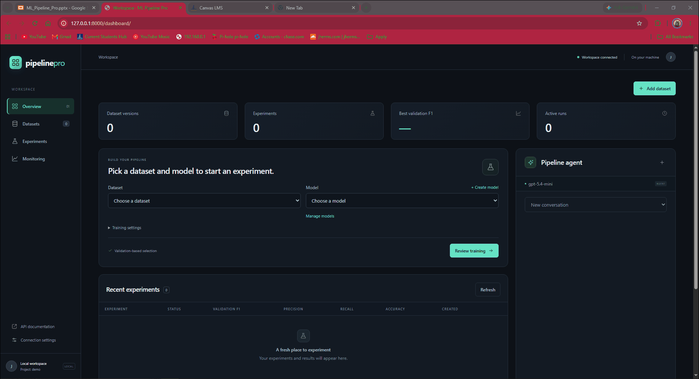

# Project Title: ML Pipeline Pro

> Turn classification CSVs into reproducible PyTorch MLP or logistic-regression
> experiments, tune models with Optuna, and monitor inference with Grafana.
> LangChain adds conversational guidance and reviewed Python drafts alongside
> separate model-management, tuning and monitoring APIs.

## 👥 Team Members & Contributions

As per course requirements, all three members must actively collaborate and commit
to this repository. Participation by all three is **not demonstrated** by the
available evidence.

Contributions below are grounded in published Git history through `baa8189`
(October 20, 2026). Commit authorship records submitted work; it does not establish
how much was written manually versus with AI assistance. No contributions outside
Git were reported for this audit.

* **Jacob Hermsmeyer** ([JacobHermsmeyer21](https://github.com/JacobHermsmeyer21)) - Backend/services, dataset and model registration, serial PyTorch training, Optuna tuning and recovery, LangChain tools and Python drafts, monitoring, Docker/Kubernetes/CI, original dashboard, CSV preparation/column versions/deletion, deployment diagnostics, OpenAI integration, logistic regression, short IDs and classification metrics. Representative commits: `0e37e6e`, `5c5f429`, `c31898c`, `a44452e`. Maintained implementation and subsequent feature work are present in the current tree.
* **Mingma Lama** ([lama9811](https://github.com/lama9811); also commits as Mingma) - Astro/React dashboard redesign, mocked-API browser regression tests and build checks, CSP changes, Claude backend and output-budget correction, public-deployment plan, presentation slides/PDF, and an earlier submission README. Representative commits: `20bef4f`, `4f9b4a3`, `c0d3cb7`, `e0ac45c`, `c012423`, `1d89614`. This work was contributed and merged, then removed from the application tree by restoration commit `e7c8e76`. It remains credited in history; Astro, Claude, and those slides are absent from the current submission.
* **Nasif Ajilore** (GitHub username not supplied) - No contribution is recorded under this name in the inspected repository history, and no work outside Git has been reported. No verified contribution to report. An unidentified Git alias or unreported work cannot be ruled out.

---

## 🚀 Live Demo

* **Application URL:** Not provided. A publicly accessible deployment has not been
  verified; this requirement remains outstanding. Deployment and URL verification
  are outside this documentation update at Jacob's request.
* *Note: This live demo must be fully functional and accessible during the live
  project presentation.*

For a local presentation, follow the
[dashboard startup guide](docs/guides/dashboard.md#start-on-this-desktop) and open
`http://127.0.0.1:8000/dashboard/`. This loopback address works on the host machine
and does not satisfy the public deployment requirement.

### 🎥 Project Walkthrough



The tracked animation shows the local dashboard, including an Iris CSV import.
It decodes as 2,002 frames at 1922 × 1042; a recording does not establish current
service availability.

---

<a id="development-setup"></a>

## 🛠️ Installation & Setup

Follow these steps to set up the environment and run the project locally.

### Prerequisites

* Python **3.11–3.14**; the project's dependency manifest requires a newer Python
  than the template's generic Python 3.8+ example.
* Git and [uv](https://docs.astral.sh/uv/getting-started/installation/).
* Docker with Compose **2.24+** for the full service stack.
* Configured provider credentials or the explicitly installed local Ollama model
  and tokenizer for chat. The local course path requires no paid model API.

### Local Installation

uv creates and manages `.venv`; manual activation is unnecessary. The locked
installation uses `pyproject.toml` and `uv.lock`, rather than `requirements.txt`.
Run the commands below in PowerShell.

Dependencies are declared in [pyproject.toml](pyproject.toml) and resolved in
[uv.lock](uv.lock). Python 3.11–3.14 is supported; CI checks Python 3.11 and 3.13.
FastAPI/Uvicorn serve the APIs; PyMongo connects to a MongoDB replica set;
Redis/Celery queue serial work; PyTorch, NumPy, scikit-learn and Optuna provide
classification and Bayesian tuning. LangChain integrates the hosted OpenAI or
local Ollama agent. Prometheus/Grafana provide monitoring. The current dashboard
is packaged HTML/CSS/JavaScript and needs no Node/Astro build.

For Python development, install uv, then run:

```powershell
git clone https://github.com/JacobHermsmeyer21/ML-Pipeline-Pro.git
Set-Location ML-Pipeline-Pro
uv sync --locked --extra training
# Create configuration only if it does not already exist.
if (-not (Test-Path .env)) { Copy-Item .env.example .env }
uv run --locked --extra training python examples/train_local.py
```

The last command runs the synthetic classification example without external
services. Full API workflows need MongoDB/Redis; chat additionally needs its
configured provider. Settings and secret handling are documented in
[.env.example](.env.example) and the [setup guide](docs/guides/setup.md).

For the base service stack, install Docker with Compose 2.24 or later and run:

```powershell
docker compose up --build --wait --wait-timeout 300
Invoke-RestMethod http://127.0.0.1:8000/api/v1/health/ready
```

Open [interactive API docs](http://127.0.0.1:8000/docs). The stack starts the API,
worker, recovery scheduler, MongoDB replica set, and Redis. Metadata requests
require `X-Project-ID` and, when configured, `X-API-Key`. Stop with
`docker compose down`; named volumes retain data and artifacts.

Follow the [setup guide](docs/guides/setup.md) for host development, configuration,
custom data, and shared artifact storage. Chat defaults to disabled; enabling it
requires configured OpenAI credentials or an installed local model with its
verified artifact-specific token counter. See the
[OpenAI guide](docs/guides/openai-agent.md) or
[local conversation development](docs/guides/conversation-development.md).

The base stack disables chat and uploads and does not start Grafana. Use the
[dashboard overlays](docs/guides/dashboard.md#start-on-this-desktop) for the browser
workflow and [domain services](docs/guides/domain-services.md),
[monitoring](docs/guides/monitoring-demo.md) and
[Kubernetes](docs/guides/kubernetes-demo.md) for the separated deployment.

---

## 📊 Dataset

* **Source:** Kaggle, as identified by the team; see the
  [Iris Species dataset listing](https://www.kaggle.com/datasets/uciml/iris).
  The demo uses the local `Downloads/IRIS.csv`; its exact Kaggle download listing
  was not recorded. [Local-file provenance](assets/iris/source.json) retains its
  SHA-256, size, schema and class counts. Iris was used in Fisher's 1936 work and
  is also available from [UCI](https://archive.ics.uci.edu/dataset/53/iris).
* **Description:** 150 flowers, with 50 each of `Iris-setosa`, `Iris-versicolor`
  and `Iris-virginica`. Four numeric measurements in centimeters predict species:
  sepal length/width and petal length/width. The supplied Kaggle description lists
  `Id`, `SepalLengthCm`, `SepalWidthCm`, `PetalLengthCm`, `PetalWidthCm` and `Species`.
  The actual local CSV instead has `sepal_length`, `sepal_width`, `petal_length`,
  `petal_width` and `species`, with no identifier column. Only the four flower
  measurements are model inputs.
* **Data Pipeline:** Download/extract an Iris CSV from Kaggle, then upload it using
  the [dashboard workflow](docs/guides/dashboard.md). For the local variant select
  `species` as target, all four measurement columns as features, numeric treatment,
  no supplied split, seed 42 and stratified 70/15/15 percentages. The saved `d5`
  version has **104 training / 23 validation / 23 test** rows after integer
  allocation; species map to class IDs 0/1/2 in the order above. Preparation saves
  immutable hashes, reviewed settings and split membership. Training fits feature
  normalization on training rows only. See the
  [saved preparation recipe](assets/iris/manifest.json) and
  [CSV preparation contracts](docs/reference/api.md#raw-csv-preparation).

The Iris CSV is not tracked in this repository; download it separately. A file
with the six-column Kaggle schema requires selecting `Species` as target and
excluding `Id`; that different input is not an exact reproduction of the recorded
local file. The tracked [synthetic CSV](examples/data/classification.csv) remains
available for the standalone installation smoke test, separate from these Iris
results.

---

## 🧠 Model Architecture & Training

* **Algorithm:** MLP (linear → ReLU → linear) or logistic regression (linear
  classifier), supporting binary and multiclass classification.
* **Frameworks Used:** PyTorch for classifiers, NumPy/scikit-learn for preparation
  and checks, Optuna for bounded Bayesian tuning, and LangChain for the separate
  pre-trained conversational model. No language-model training is required.
* **Training Process:** Serial CPU minibatch Adam with cross-entropy. Defaults:
  seed 42, 30 epochs, batch size 16, learning rate 0.01, MLP hidden width 16 and
  a 60-second runtime limit. Fit normalization on training rows, select by
  validation metrics, then evaluate held-out test rows. Logistic regression can
  add L2 regularization. Logistic tuning and AI mutation proposals remain
  unsupported; manual training, comparison, downloads and registration work.

The [capabilities and operational limits](docs/guides/project-capabilities.md)
retain detailed feature/API contracts and dated acceptance from the prior README.
See the [API reference](docs/reference/api.md),
[classification/tuning workflows](docs/guides/workflows.md),
[complete tutorial](docs/guides/midterm-walkthrough.md) and
[generated Python drafts](docs/guides/snippet-generation.md).

---

## 📈 Evaluation & Results

The results below come from the existing successful **Iris experiment `e32`**
(`e4ba8047-52f8-4493-936a-0e9903977492`), dataset `d5` / `IRIS v1`, project `demo`.
It completed October 20, 2026 at 23:49 EDT (October 21 at 03:49 UTC). The model is
an MLP with four inputs, 16 hidden units, ReLU and three outputs; configuration:
seed 42, 30 epochs, batch size 16, learning rate 0.01 and a 60-second limit.
Validation macro F1 selected **epoch 6**. This is one saved run, with no new
training or final evaluation performed for this documentation update.

| Metric | Training Set (104 rows) | Validation Set (23 rows) | Test Set (23 rows) |
| :--- | :--- | :--- | :--- |
| Accuracy | Not reported | 1.000000 | 0.826087 |
| Macro precision | Not reported | 1.000000 | 0.844444 |
| Macro recall | Not reported | 1.000000 | 0.833333 |
| Macro F1-score | Not reported | 1.000000 | 0.830688 |
| Loss | Not reported | Not reported | Not reported |

Accuracy is the fraction of correct predictions. Precision, recall and F1 are
computed per class as `TP/(TP+FP)`, `TP/(TP+FN)` and `2TP/(2TP+FP+FN)`, then
averaged equally over the three dataset classes; undefined ratios contribute zero.
The selected checkpoint's held-out test accuracy is **82.61%** and macro F1 is
**0.830688**. Validation results select the checkpoint; test results do not.
Perfect validation performance on 23 rows does not imply perfect held-out
performance or establish generalization across datasets.

[Saved experiment metrics](assets/iris/experiment.json),
[dataset metadata](assets/iris/dataset.json),
[model metadata](assets/iris/model.json) and the
[hash/size-verified training manifest](assets/iris/manifest.json) retain the actual
configuration, metrics, dependency versions, preparation and input hashes.
The [evidence notes](assets/iris/README.md) describe capture provenance and limits.
Training-set evaluation metrics, loss curves, confusion matrices and ROC curves
were not captured and are not claimed. The
[assets index](assets/README.md) separates these Iris records from historical
Drug200 and other verification runs. Monitoring observations and AI explanations
are separate from classifier evaluation metrics.

<a id="run-checks"></a>

### Verification

Install [uv](https://docs.astral.sh/uv/getting-started/installation/), then run:

```powershell
uv sync --locked --extra training
uv run --locked --extra training ruff check .
uv run --locked --extra training ruff format --check .
uv run --locked --extra training pytest -m "not integration" --cov
uv pip check
```

The [verification guide](docs/guides/verification.md) covers ordinary integration
and isolated recovery. Both use explicit opt-in flags; missing services or skipped
selected cases are verification gaps. Historical results live in
[project status](docs/project/project-status.md).

Full bounded laptop Kubernetes AI acceptance remains open; passing desktop,
standalone and unbounded diagnostic runs have different scopes. See
[current status](docs/project/project-status.md) and the
[course checklist](docs/project/course-requirements.md).

---

## 🧑‍💻 Git Workflow & Guidelines

1. **Branch Frequently:** Create feature branches, for example
   `git checkout -b feature/your-feature`, and merge reviewed work through pull
   requests.
2. **Commit Regularly:** Run relevant checks and use descriptive messages, for
   example `git commit -m "Document classification metrics"`.
3. **Pull Before Push:** Fetch `origin` before major changes and again before
   pushing; compare the upstream and inspect `origin/main`. Integrate applicable
   incoming work, preserve local changes and published history, and rerun affected
   checks. On a clean, non-diverged `main`, use `git pull --ff-only origin main`.
   Resolve divergence deliberately; never force-push to bypass incoming changes.

The history contains repeated commits from October 6–20, 2026, feature branches,
and merged pull requests, including [PR #1](https://github.com/JacobHermsmeyer21/ML-Pipeline-Pro/pull/1)
and [PR #2](https://github.com/JacobHermsmeyer21/ML-Pipeline-Pro/pull/2).
At audit revision `baa8189`, `git shortlog -sne baa8189` records 131 commits by
Jacob's identity and 20 by Mingma's two identities (18 + 2, including merges).
These counts describe reachable history, including work later removed; they are
not measures of effort. **Active Git collaboration by all three members is not
demonstrated:** no third contributor identity appears. This requirement remains
unmet on the available evidence.

Substantive changes use written plans and human review; completed major changes
are checked, committed and pushed. See [repository workflow](AGENTS.md) and the
[development method](docs/project/development-methodology.md).

See the [documentation index](docs/README.md) and [roadmap](PLAN.md). Application
code is in [`src/ml_pipeline_pro/`](src/ml_pipeline_pro/), tests in
[`tests/`](tests/) and runnable examples in [`examples/`](examples/).
