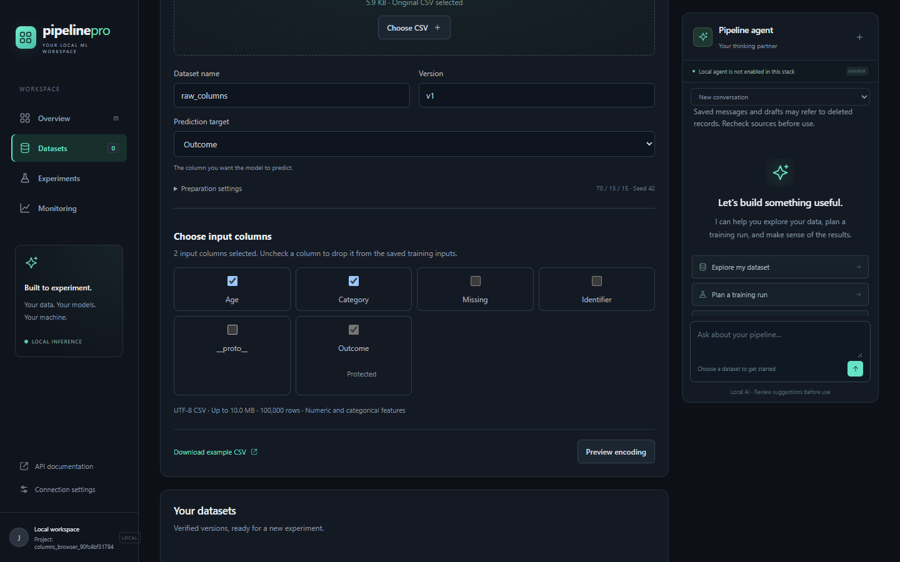
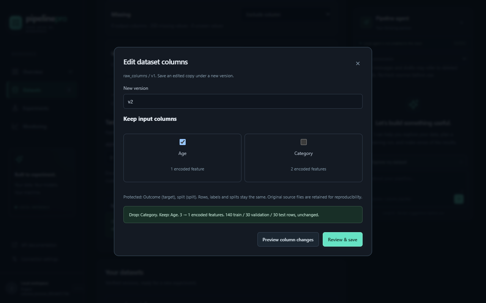
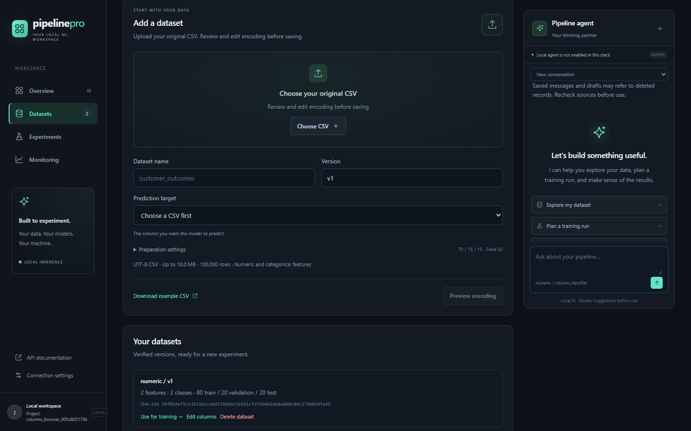

# Dataset column editing evidence

October 19, 2026, America/New_York. Jacob approved the
[written design](../../plans/2026-10-19-dataset-column-editing-plan.md) with
"looks good" after plan commit `270ef7d`. This record covers the implementation
workspace atop that commit, including concurrently developed deletion
coordination. [Source/dependency hashes](provenance.json) distinguish the
uncommitted execution tree from that planning-only baseline. Final implementation
commit/push is recorded in the task handoff. The separately validated deletion
foundation subsequently landed and was pushed as `04c55b5`; the column-editing
commit follows it. All recorded source hashes still match the implementation
workspace after that dependency commit.

## Executed outcomes

| Check | Observed result | Raw evidence |
| --- | --- | --- |
| Locked environment, lint, formatting and installed dependency compatibility | Pass; uv 0.12.23, CPython 3.11.5 on Windows. | [Final checks](final-checks.json), command context below; dependency versions in provenance. |
| Full fast suite with coverage | 740 passed, 114 integration deselected; 79% aggregate coverage. | [Output](fast-final.log), [JUnit](fast-final-junit.xml). |
| Full ordinary suite, both integration/worker flags enabled | 104 passed, 749 non-ordinary deselected; no selected skips. | [Output](ordinary.log), [JUnit](ordinary-junit.xml). |
| Added real MongoDB projection/lifecycle cases | All six pass: separate version deletion, replay, real uncertain commit, publication-first exclusion, deletion-first rejection and cancellation ownership. | [Output](columns-integration.log), [JUnit](columns-integration.xml). |
| Actual JSON request cap | 65,536 bytes accepted, 65,537 rejected with correlated `column_limit_exceeded`. | [Recorded boundary](live-json-cap.json). |
| Chrome browser workflow | Pass at 1440x900 and 1280x800; no page exceptions; five actual serial worker runs with artifact hash/size verification. | [Execution report](browser-report.json), [output](browser-final.log), screenshots below. |
| Package build | sdist and wheel built; final column source bytes match wheel assets. Archive inspection excludes `.uv-cache`, `.tools` and `artifacts`. | [Archive hashes/inspection](package-inspection.json), [final build](package-build-current.log); initial restricted-network failure retained locally. |
| Isolated worker/dependency recovery | All ten original cases pass in 387.71 seconds, serially; no selected skips. | [Output](recovery.log), [JUnit](recovery-junit.xml); namespace adaptation below. |
| Updated existing dashboard | Matching domain services/workers updated after two idle checks; ready on port 8000. Final packaged script, protected target and preserved keyboard focus pass without saving user data. | [Dashboard smoke](demo-smoke.json). |

The browser starts from a generated 200-row raw CSV, removes entirely missing and
high-cardinality columns before preview, and also drops a literal `__proto__`
column. It saves 140/30/30 splits, trains, then removes an entire categorical
group from the saved version and trains again. It checks cancellation, invalidated
preview, duplicate clicks, numeric editing, a deliberately lost committed save
response, reload/reconnection with the same request, and project switching.
It then erases the raw parent and numeric child separately and trains their
survivors through the actual shared, read-only worker volume. Parentless matching
replay succeeds; no derived training uses a parent-record lookup.

## Provenance and execution boundaries

The isolated compatibility stack is `mlpp-columns-validation-20261019`, with API
18001, MongoDB 37018 and Redis 16380. It uses a distinct image/tag and named
volumes. [Image IDs](images.json) record exact running images. Existing user demo
records/volumes are separate. All mutations in verification use generated
disposable projects; the report preserves real IDs and measured validation
metrics, not a quality claim about external data.

Commands use the repository-local uv executable with `--cache-dir .uv-cache`,
then the locked training extra and [normal gates](../../guides/verification.md).
Ordinary integration sets both `MLPP_RUN_INTEGRATION=1` and
`MLPP_RUN_WORKER_INTEGRATION=1`, and the three `MLPP_TEST_*` endpoint overrides
point to that isolated stack. The browser runs
[the checked-in acceptance script](../../../scripts/verify_column_dashboard.py)
with installed Chrome and Playwright 1.64.0 in an ignored verification directory.
No project dependency or model is added for column editing.

Recovery uses an otherwise unchanged copy of all ten original
[recovery cases](../../../tests/integration/test_recovery.py), with
`MLPP_RUN_RECOVERY_INTEGRATION=1`. The
[exact namespace patch](recovery-namespace.patch) and
[Compose overlay](recovery-overlay.yaml) change only ports, image tag and
evidence/control paths to avoid another session's recovery resources. Assertions,
timeouts, test cases and serial execution are unchanged. It uses API 28001,
MongoDB 47018 and Redis 26380. Raw process-loss snapshots/service logs stay under
local `artifacts/column-editing/recovery/`; retained summary/JUnit follow completion.

## Failures, warnings and review limits

The [first browser attempt](browser.log) completed raw upload/edit/training, then
timed out after reloading into the default `demo` project while searching for a
record in the generated project. The harness now explicitly reconnects after
reload; concurrent deletion work also restores the tab's nonsecret project ID.
That failure is retained separately
from the final pass; no application/test assertion was weakened.

The first package build could not download Hatchling inside the restricted
sandbox. The permitted retry built both packages. uv warns that its cache lies
inside the source directory; explicit archive inspection confirms excluded cache,
tools and evidence paths. No new runtime dependency or lockfile upgrade belongs
to this feature. Temporary lint/format failures from concurrent deletion-script
edits were resolved before the recorded final checks.

The [final cached package build](package-build-current.log) includes the final
focus-preservation change. The local dashboard uses the existing Compose
project/volumes and matching model, tuning, monitoring, worker and scheduler
images. Its update did not remove/recreate volumes or modify existing datasets.

Independent concurrency review is unavailable; implementing-assistant inspection
is self-review. Human usefulness review of the completed controls is still
pending. These gaps remain distinct from the executed assertions. No course row,
CPU-laptop AI acceptance, concurrent training capacity or model-quality improvement
is established by column editing.
